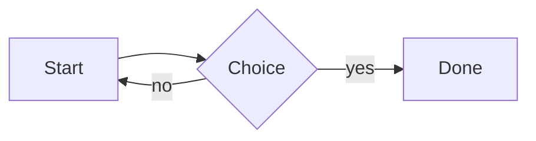
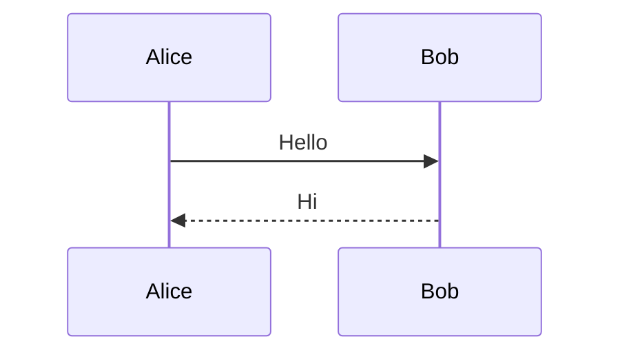
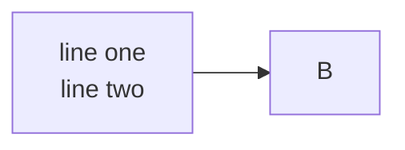
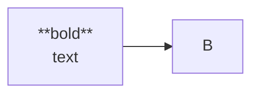
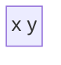
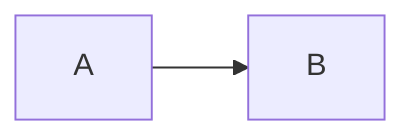

# Mermaid examples for the store review

Rendered by scripts/harness/harness.mjs; each has to come back as SVG that
Typora accepts. The last four are from typora/typora-extensions-and-themes#4.

